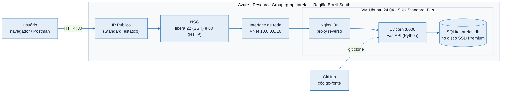
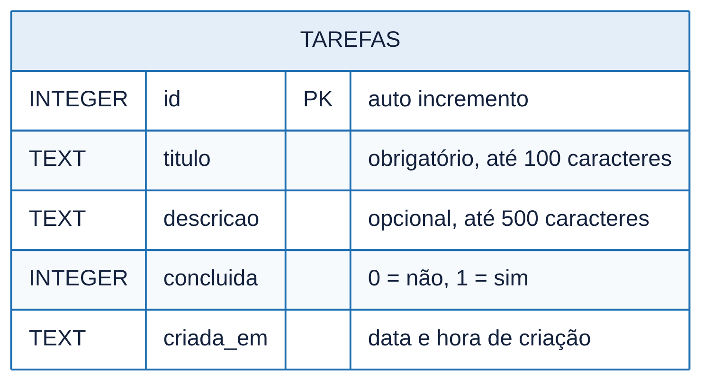
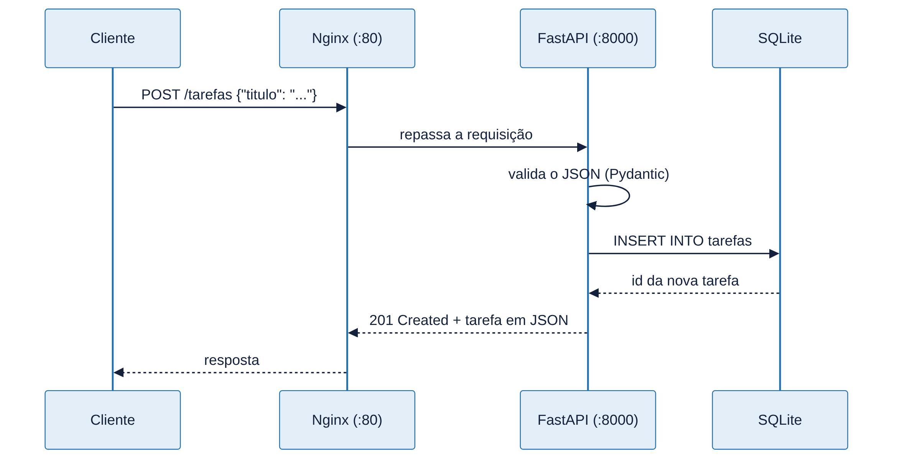
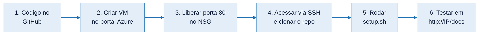

# API de Tarefas — FastAPI + SQLite no Azure

API REST básica para cadastrar tarefas, com banco **SQLite**, hospedada de ponta a ponta em uma **máquina virtual Linux no Microsoft Azure**.

- **URL da API:** `http://<IP_PUBLICO_DA_VM>`
- **Documentação interativa (Swagger):** `http://<IP_PUBLICO_DA_VM>/docs`

## Tecnologias

| Camada | Tecnologia |
|---|---|
| Linguagem | Python 3.12 |
| Framework da API | FastAPI + Pydantic |
| Servidor de aplicação | Uvicorn |
| Proxy reverso | Nginx |
| Banco de dados | SQLite (arquivo `tarefas.db`) |
| Nuvem | Microsoft Azure: VM Standard_B1s, Ubuntu 24.04 LTS |

## Arquitetura



O usuário acessa o IP público da VM na porta 80. O NSG (firewall do Azure) libera só as portas 22 (SSH) e 80 (HTTP). Dentro da VM, o Nginx recebe a requisição e repassa para o Uvicorn na porta 8000, que roda a API em FastAPI. A API grava e lê os dados no arquivo SQLite, que fica no disco gerenciado da VM.

## Banco de dados



## Fluxo de uma requisição



## Endpoints

| Método | Rota | Descrição | Resposta |
|---|---|---|---|
| GET | `/health` | Verifica se a API está no ar | 200 |
| GET | `/tarefas` | Lista todas as tarefas | 200 |
| GET | `/tarefas/{id}` | Busca uma tarefa | 200 / 404 |
| POST | `/tarefas` | Cria uma tarefa | 201 / 422 |
| PUT | `/tarefas/{id}` | Atualiza uma tarefa | 200 / 404 |
| DELETE | `/tarefas/{id}` | Remove uma tarefa | 204 / 404 |

Exemplo de corpo para POST/PUT:

```json
{ "titulo": "Estudar Azure", "descricao": "Revisar VMs e NSG", "concluida": false }
```

## Rodar localmente

```bash
python3 -m venv venv
source venv/bin/activate        # no Windows: venv\Scripts\activate
pip install -r requirements.txt
uvicorn app.main:app --reload
```

Abra `http://127.0.0.1:8000/docs`.

Testes automatizados:

```bash
pip install pytest httpx
pytest
```

## Implantação no Azure



1. **Criar a VM** no portal Azure: Ubuntu Server 24.04 LTS, tamanho `Standard_B1s`, autenticação por chave SSH, portas de entrada 22 e 80.
2. **Conectar via SSH:**
   ```bash
   ssh -i chave.pem azureuser@<IP_PUBLICO_DA_VM>
   ```
3. **Clonar e instalar:**
   ```bash
   git clone https://github.com/<usuario>/api-tarefas-azure.git
   cd api-tarefas-azure
   sudo bash deploy/setup.sh
   ```
4. **Testar:** `http://<IP_PUBLICO_DA_VM>/docs`

O `setup.sh` instala Python, Nginx e SQLite, cria o ambiente virtual, registra a API como serviço `systemd` (sobe sozinha se a VM reiniciar) e configura o Nginx.

Comandos úteis na VM:

```bash
sudo systemctl status api-tarefas      # status do serviço
sudo journalctl -u api-tarefas -f      # logs da API
sqlite3 /var/lib/api-tarefas/tarefas.db "SELECT * FROM tarefas;"
```

## Estrutura do projeto

```
api-tarefas-azure/
├── app/
│   ├── main.py            # rotas da API
│   └── database.py        # conexão e criação da tabela SQLite
├── tests/test_api.py      # testes automatizados
├── deploy/
│   ├── setup.sh           # instalação na VM
│   ├── api-tarefas.service# serviço systemd
│   └── nginx-api-tarefas.conf
├── docs/diagramas/        # diagramas (fonte .mmd e imagem .png)
└── requirements.txt
```
